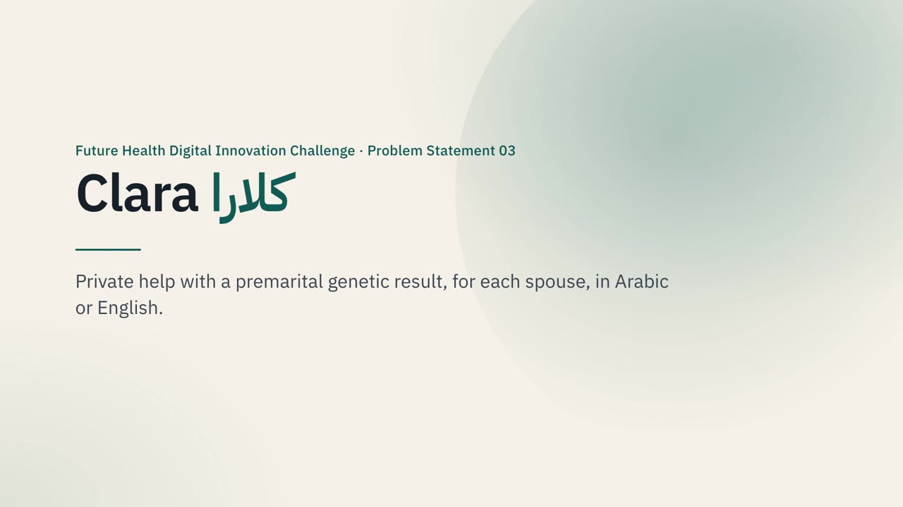

# Clara · كلارا

Private help with a premarital genetic result, for each spouse, in Arabic or English, and a route to care.

Future Health Digital Innovation Challenge 2026 (Department of Health Abu Dhabi) · Problem Statement 03 ·
Team parallelparadox. Final submission, 20 November 2026.

## Links

| What | Link |
| --- | --- |
| Live prototype (no login) | https://clara.q7m4v2k9orbit.workers.dev/en |
| Demo video, 3 minutes | https://clara.q7m4v2k9orbit.workers.dev/en/video |
| Demo video, MP4 file | https://praveenashukla.github.io/clara/video/clara-demo.mp4 |
| Project page: how Clara is built | https://praveenashukla.github.io/clara/ |
| Deck (PDF, 31 slides) | https://praveenashukla.github.io/clara/Clara-Deck.pdf |
| Technical documentation (PDF, 37 pages) | https://praveenashukla.github.io/clara/Clara-Technical-Documentation.pdf |
| Evidence: every claim mapped to a screen and a test | https://clara.q7m4v2k9orbit.workers.dev/en/evidence |

## Try it

1. Open https://clara.q7m4v2k9orbit.workers.dev/en. No account and no code are needed.
2. Press "Start: one couple's result" for the guided demo, from result to referral in about a minute.
3. Pick a role (either spouse's phone, the specialist, the family doctor, the lab, the programme office or the
   rehearsal) and a language (English or العربية).

Every couple is synthetic. The M42 lab report, the Malaffi connection, the counsellor calendar and UAE PASS on the demo
phones are prototype stand-ins, listed on the prototype's Privacy page. Clara is not a medical device and is not
affiliated with or endorsed by the Department of Health, M42, MBZUAI, G42 or Microsoft.

## Source code

The application's source code is private and available to the review panel on request. This repository holds the
project page, the deck, the technical documentation (with its LaTeX source in `docs-src/`) and the demo video.
